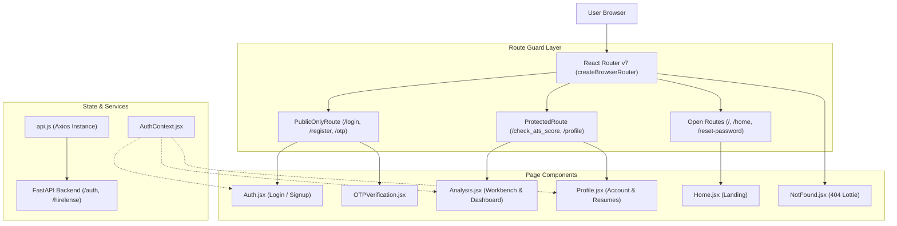
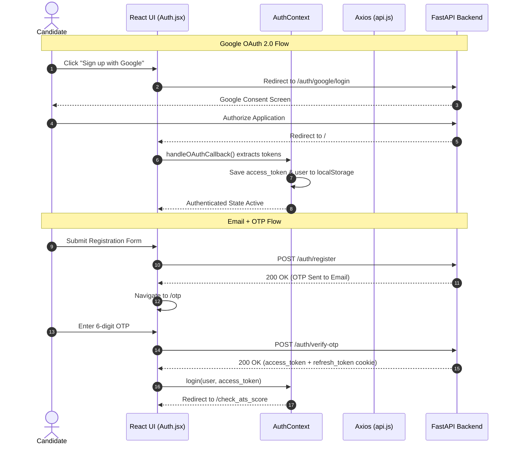

# 🎨 HireLense AI — Frontend Architecture & Client Documentation

> Premium, data-driven single-page application (SPA) built with **React 19**, **Vite**, **Chart.js**, **React Router v7**, and **DotLottie**, delivering an ATS analysis and resume intelligence dashboard.

---

## 📋 Table of Contents
1. [Project Overview](#-project-overview)
2. [Frontend Architecture](#-frontend-architecture)
3. [Technology Stack](#-technology-stack)
4. [Folder Structure](#-folder-structure)
5. [Application Architecture Diagram](#-application-architecture-diagram)
6. [Routing Architecture](#-routing-architecture)
7. [Component Hierarchy](#-component-hierarchy)
8. [State Management](#-state-management)
9. [Authentication Flow](#-authentication-flow)
10. [API Integration & Axios Configuration](#-api-integration--axios-configuration)
11. [Protected Routes & Authorization](#-protected-routes--authorization)
12. [Important Pages & Functionality](#-important-pages--functionality)
13. [Reusable Components & Utilities](#-reusable-components--utilities)
14. [Form Validation & Error Handling](#-form-validation--error-handling)
15. [Responsive UI Implementation](#-responsive-ui-implementation)
16. [Environment Variables](#-environment-variables)
17. [Installation Instructions](#-installation-instructions)
18. [Development Server](#-development-server)
19. [Production Build](#-production-build)
20. [Deployment Instructions](#-deployment-instructions)
21. [Common Errors & Troubleshooting](#-common-errors--troubleshooting)

---

## 🚀 Project Overview

The **HireLense AI Frontend** provides an intuitive SaaS user interface for candidate resume benchmarking and ATS scoring. Designed with a restrained modern aesthetic (clean white surfaces, neutral charcoal typography, and subtle micro-interactions), it offers:
- **Instant ATS Scoring & Visualizations:** Visual breakdown of keyword matches, project quality, and missing competencies using Chart.js doughnut and gradient line charts.
- **Side-by-Side Ingestion Workbench:** Desktop flex workbench enabling candidates to pair PDF uploads with specific target Job Descriptions (JDs) for customized evaluations.
- **Seamless Identity State:** Synchronized state for Google OAuth 2.0 and Email/OTP registrations with auto-refreshing authentication sessions.
- **Export & Portability:** Native high-fidelity print/export stylesheets for client-side PDF generation.

---

## 🏛️ Frontend Architecture

The frontend follows a modern React SPA pattern emphasizing component modularity and decoupled state:

```
┌─────────────────────────────────────────────────────────────┐
│                      Browser Window                         │
│       React 19 Virtual DOM · React Router v7 Router         │
└──────────────────────────────┬──────────────────────────────┘
                               │
┌──────────────────────────────▼──────────────────────────────┐
│                    Global Auth Provider                     │
│    (Session State · User Profile · OAuth Hash Interceptor)   │
└──────────────┬───────────────────────────────┬──────────────┘
               │                               │
┌──────────────▼──────────────┐ ┌──────────────▼──────────────┐
│       Public Views          │ │       Protected Views       │
│  Home · Login · Register    │ │ Analysis · Profile · Warning│
└──────────────┬──────────────┘ └──────────────┬──────────────┘
               │                               │
┌──────────────▼───────────────────────────────▼──────────────┐
│                     Axios API Client                        │
│   Bearer Interceptor · Auto-Refresh Queue · withCredentials │
└──────────────────────────────┬──────────────────────────────┘
                               │ HTTPS / JSON
┌──────────────────────────────▼──────────────────────────────┐
│                  FastAPI Backend Server                     │
└─────────────────────────────────────────────────────────────┘
```

---

## 🛠️ Technology Stack

| Library / Tool | Version | Purpose & Technical Rationale |
|---|---|---|
| **React** | `19.2.8` | Core UI library utilizing modern concurrent rendering features and hooks. |
| **Vite** | `^8.3.0` | Ultra-fast build tool and development server with instant Hot Module Replacement (HMR). |
| **React Router** | `^7.18.4` | Declarative client-side routing supporting data routers, nested layouts, and route guards. |
| **Chart.js** | `^4.6.1` | High-performance HTML5 canvas rendering for radar, doughnut, and gradient line charts. |
| **React-Chartjs-2** | `^5.3.1` | React wrapper for Chart.js ensuring smooth component lifecycle integration. |
| **Axios** | `^1.20.0` | Promise-based HTTP client customized with request/response interceptors for silent token refresh. |
| **DotLottie React** | `^0.19.16` | Lightweight, scalable vector animations for loading states and 404 views. |
| **React Toastify** | `^11.1.0` | Non-intrusive, customizable toast alerts for system feedback and notifications. |
| **Font Awesome** | Free CDN | Scalable vector icons for navigational pills, status indicators, and KPI cards. |

---

## 📂 Folder Structure

```text
frontend/
├── public/                     # Static assets served as-is
├── src/
│   ├── anim/                   # DotLottie Animation Components
│   │   ├── LoadingAnimation1.jsx # Global route transition overlay
│   │   ├── LoadingAnimation2.jsx # Circular pulsing loader
│   │   ├── LoadingAnimation3.jsx # Accent geometric spinner
│   │   ├── LoadingAnimation4.jsx # Dedicated resume analysis parser loader
│   │   └── LoadingAnimation5.jsx # 404 Page Not Found interactive animation
│   ├── api/                    # HTTP & Network Layer
│   │   └── api.js              # Axios instance with auth headers & refresh queue
│   ├── assets/                 # Local images, SVG illustrations, fonts
│   │   ├── fonts/              # BirdsOfParadise.ttf calligraphy typography
│   │   └── upload_resume.png   # Dropzone illustration
│   ├── auth/                   # Authentication Views & Context
│   │   ├── Auth.jsx            # Unified Login/Register screen with flip animation
│   │   ├── AuthContext.jsx     # Global authentication provider & session hooks
│   │   ├── ForgotPassword.jsx  # Multi-step password recovery (Email -> OTP -> New Pass)
│   │   └── OTPVerification.jsx # Standalone 6-digit email confirmation screen
│   ├── build/                  # Under-construction & Warning modules
│   │   └── warning.jsx         # Modal prompt for upcoming resume builder
│   ├── components/             # Reusable Visual Elements
│   │   ├── AtsScoreCircle.jsx  # Animated SVG circular gauge for ATS scores
│   │   └── Navbar.jsx          # Responsive top navigation with auth state
│   ├── lib/                    # Storage and notification helpers
│   │   ├── analysisStorage.js  # LocalStorage persistence for generated reports
│   │   └── toast.js            # Unified toast notification wrappers
│   ├── pages/                  # Top-Level Page Views
│   │   ├── Analysis.jsx        # Dual-column upload workbench & SaaS dashboard
│   │   ├── Home.jsx            # Landing page with hero, testimonials, and feature grid
│   │   ├── NotFound.jsx        # 404 error page with Lottie animation
│   │   ├── Profile.jsx         # Account settings and uploaded resumes list
│   │   └── ProtectedRoute.jsx  # Route guards for authenticated/public-only views
│   ├── styles/                 # Scoped Modular Stylesheets
│   │   ├── Analysis.css        # Dashboard, workbench, chart styling, and print rules
│   │   ├── Auth.css            # Auth cards, inputs, and animations
│   │   ├── ForgotPassword.css  # Recovery modal styling
│   │   ├── Home.css            # Landing page hero, grid, and responsiveness
│   │   ├── Navbar.css          # Navigation bar layout and mobile drawer
│   │   ├── NotFound.css        # 404 centering, typography, and button styles
│   │   ├── OTPVerification.css # Digit input grid
│   │   └── profile.css         # Profile card, badges, and document table
│   ├── App.jsx                 # Route definitions and route transition layout
│   ├── index.css               # Global theme tokens, typography, and CSS resets
│   └── main.jsx                # Application root mounting React onto #root
├── .env.example                # Canonical frontend environment template
├── index.html                  # HTML entry point with meta tags & preloaded fonts
├── package.json                # Project dependencies and npm scripts
├── vercel.json                 # Vercel SPA routing rewrite rules
└── vite.config.js              # Vite bundler configuration
```

---

## 📊 Application Architecture Diagram



---

## 🚦 Routing Architecture

HireLense implements **React Router v7** using `createBrowserRouter` defined in `src/App.jsx`:

| Path | Component | Protection | Description |
|---|---|---|---|
| `/` or `/home` | `Home.jsx` | Public | Hero landing page, feature highlights, and recruiter endorsements. |
| `/login` | `Auth.jsx` | Public-Only | Sign-in interface with email/password and Google OAuth. |
| `/register` | `Auth.jsx` | Public-Only | Sign-up screen triggering email OTP dispatch. |
| `/otp` | `OTPVerification.jsx` | Public-Only | 6-digit verification code screen for registration. |
| `/reset-password` | `ForgotPassword.jsx`| Public | Multi-step password reset workflow. |
| `/check_ats_score`| `Analysis.jsx` | **Protected** | Dual-column upload workbench & full ATS analytics report. |
| `/profile` | `Profile.jsx` | **Protected** | Candidate profile info, verification status, and uploaded PDFs. |
| `/build_resume` | `warning.jsx` | **Protected** | Coming-soon notice for the interactive resume builder. |
| `*` | `NotFound.jsx` | Fallback | Interactive 404 page with Lottie animation and home button. |

---

## 🌳 Component Hierarchy

```text
App.jsx
└── AuthProvider (AuthContext)
    └── RouteLoadingLayout
        ├── Navbar
        │   ├── Brand Logo
        │   ├── Navigation Links (Home, Check ATS Score, Profile)
        │   └── Auth Action (Sign In / User Avatar Menu)
        ├── Outlet (Active Page)
        │   ├── [Home.jsx]
        │   │   ├── HeroSection
        │   │   ├── CompanyLogos
        │   │   └── FeatureGrid
        │   ├── [Analysis.jsx]
        │   │   ├── Upload Workbench (Dual-Column Flex)
        │   │   │   ├── Dropzone Card (PyMuPDF Target)
        │   │   │   └── Target JD Card (Textarea)
        │   │   ├── LoadingAnimation4 (Parser Active)
        │   │   └── Dashboard View
        │   │       ├── Header & Candidate Banner (Birds of Paradise Font)
        │   │       ├── AtsScoreCircle Gauge
        │   │       ├── KPI Metrics Cards
        │   │       ├── Doughnut Chart (Skill Match Breakdown)
        │   │       ├── Line Chart (Project Depth Analysis)
        │   │       └── Improvements Table
        │   └── [Profile.jsx]
        │       ├── Profile Card
        │       └── Uploaded Resumes Data List
        └── ToastContainer (Global Notifications)
```

---

## 🔄 State Management

HireLense balances global context with localized persistence:

1. **`AuthContext.jsx` (Global Context)**:
   - Manages `user` (`{ id, name, email, picture, is_verified }`) and `loading` states.
   - Automatically handles the `#oauth-callback?...` URL hash upon returning from Google OAuth.
   - Syncs session data with `localStorage.getItem("user")`.

2. **`analysisStorage.js` (Local Persistence)**:
   - Stores parsed ATS reports in browser `localStorage`.
   - Prevents loss of analysis data during page reloads.
   - Clears data automatically when the candidate logs out.

3. **In-Flight Upload State (`Analysis.jsx`)**:
   - `file`: Raw File object selected via drag-and-drop or file picker.
   - `jd`: Target Job Description text.
   - `uploading`: Controls removal of the upload card and presentation of `LoadingAnimation4`.

---

## 🔑 Authentication Flow



---

## ⚡ API Integration & Axios Configuration

All network communication routes through a centralized Axios client in `src/api/api.js`:

```javascript
const api = axios.create({
    baseURL: import.meta.env.VITE_API_URL,
    withCredentials: true, // Transmits HTTP-only refresh cookies
});
```

### Request Interceptor
Attaches `Authorization: Bearer <access_token>` from `localStorage` to all outgoing requests.

### Response Interceptor & Silent Refresh Queue
When an API call fails with `401 Unauthorized`:
1. The request URL is verified (lifecycle routes like `/login` or `/refresh` fail immediately).
2. If already refreshing, incoming requests are placed into a `failedQueue`.
3. If not refreshing, `POST /auth/refresh` is triggered using the HTTP-only cookie.
4. On success: The new `access_token` is saved to `localStorage`, the `failedQueue` is resolved, and the original request is replayed.
5. On failure: `notifyUnauthorized()` clears `localStorage` and emits an `auth:unauthorized` window event, redirecting the user to `/login`.

---

## 🔒 Protected Routes & Authorization

Routes are protected by wrapper components in `src/pages/ProtectedRoute.jsx`:

- **`ProtectedRoute`**: Inspects `user` from `useAuth()`. If `loading`, displays `LoadingAnimation1`. If unauthenticated, redirects to `/login` while preserving location state for post-login redirect.
- **`PublicOnlyRoute`**: Prevents authenticated candidates from accessing `/login`, `/register`, or `/otp`, redirecting them to `/check_ats_score`.

---

## 📄 Important Pages & Functionality

### 1. `Home.jsx` (Landing Page)
- Features a clean, high-contrast hero section: *"Your first real interview, before the real one."*
- Interactive call-to-actions linking to free assessment.
- Responsive showcase of top tech engineering competencies.

### 2. `Auth.jsx` (Authentication Hub)
- Unified login and registration container featuring smooth tab transitions.
- Form inputs validated for email format, password complexity (uppercase, lowercase, number, length ≥ 8).
- One-click Google Social Login button.

### 3. `Analysis.jsx` (Workbench & Analytics Dashboard)
- **Workbench:** Dual-column responsive flex grid featuring an interactive dropzone and target JD textarea.
- **Loading Phase:** Swaps the upload card with `LoadingAnimation4` during AI evaluation.
- **Intelligence Dashboard:**
  - **ATS Score Gauge:** High-impact circular SVG gauge (`AtsScoreCircle`).
  - **KPI Cards:** Score, Skill Match %, Project Score, Certifications, Experience.
  - **Candidate Banner:** Renders candidate name in authentic **Birds of Paradise** calligraphy font.
  - **Doughnut Chart:** Matched vs. missing keywords.
  - **Line Chart:** Project relevance curve with vertical gradient fill.
  - **Audit Cards:** Color-coded Positives (Green) and Negatives/Deficiencies (Red).
  - **Exporting:** Client-side print stylesheet formatting report for PDF export.

### 4. `Profile.jsx` (Account Settings)
- Shows verified status badge, email, and registration date.
- Name editing modal with instant cache update.
- Uploaded resumes ledger fetching candidate documents from backend.

---

## 🧩 Reusable Components & Utilities

- **`AtsScoreCircle.jsx`**: Animated circular progress meter coloring dynamically by score tier (Green ≥80, Amber ≥65, Orange ≥50, Red <50).
- **`Navbar.jsx`**: Sticky navigation header with mobile drawer toggle and authenticated user dropdown.
- **`toast.js`**: Standardized wrappers around React Toastify (`showSuccess`, `showError`, `showInfo`).
- **`analysisStorage.js`**: Serializes and deserializes candidate ATS reports to `localStorage`.

---

## 📱 Responsive UI Implementation

The application is engineered with a **Desktop-First, Mobile-Responsive** approach:

```css
/* Desktop: Side-by-Side Flex Workbench */
.upload-workbench {
    display: flex;
    flex-direction: row;
    gap: 24px;
    width: 100%;
}

/* Mobile & Tablet: Stacked Column */
@media (max-width: 860px) {
    .upload-workbench {
        flex-direction: column;
        gap: 16px;
    }
}
```

---

## 🔑 Environment Variables

Create a `.env` file in the `frontend/` directory:

```env
# URL pointing to the FastAPI backend service
VITE_API_URL=http://localhost:8000
```

---

## 💻 Installation Instructions

```bash
# 1. Navigate to frontend directory
cd frontend

# 2. Install dependencies
npm install

# 3. Configure environment variables
cp .env.example .env
```

---

## ▶️ Development Server

Launch the Vite development server with HMR:

```bash
npm run dev
```
Open [http://localhost:5173](http://localhost:5173) in your browser.

---

## 🏗️ Production Build

Create an optimized, minified production build:

```bash
npm run build
```
Build output is saved to the `dist/` directory.

---

## 🚀 Deployment Instructions (Vercel)

The frontend includes a pre-configured `vercel.json` ensuring client-side routing works without 404s on page refresh:

```json
{
  "rewrites": [
    {
      "source": "/(.*)",
      "destination": "/index.html"
    }
  ]
}
```

### Steps to Deploy
1. Push project to GitHub.
2. Import project into [Vercel](https://vercel.com).
3. Set **Root Directory** to `frontend`.
4. Add environment variable: `VITE_API_URL=https://your-backend-api.onrender.com`.
5. Deploy.

---

## 🛠️ Common Errors & Troubleshooting

| Issue | Cause | Solution |
|---|---|---|
| `Network Error` on API requests | Backend is offline or CORS is misconfigured | Verify FastAPI server is running on `http://localhost:8000` and `FRONTEND_URL` is set in backend `.env`. |
| Session loss on refresh | Missing or blocked cookies | Ensure browser permits third-party cookies if backend and frontend are on different domains. |
| Page reload returns 404 on Vercel | Missing SPA rewrite rules | Ensure `vercel.json` is present in the `frontend/` directory with rewrite to `/index.html`. |
| Chart canvas sizing issues | Parent container lacks defined height | Ensure Chart wrappers maintain explicit relative height styles. |
